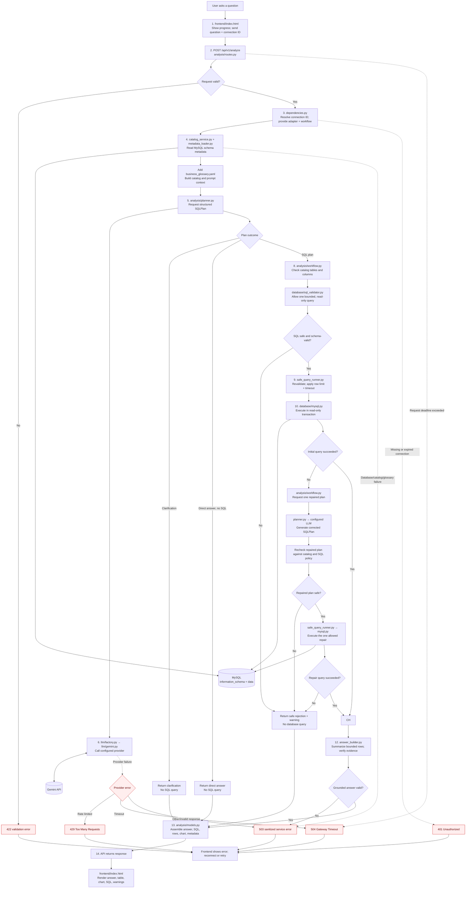
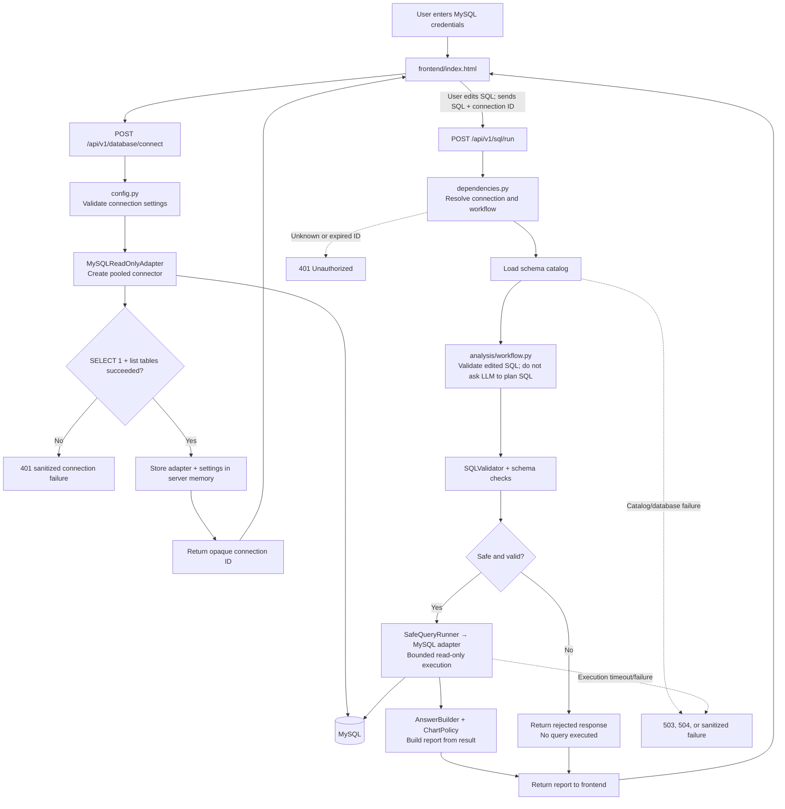

# Data Analyst AI — Roadmap and Script-wise Architecture

## 1. Current MVP status

The application already provides the core vertical slice:

- A MySQL database can be connected with a read-only user from the frontend.
- Database credentials stay in backend memory for the current server session.
- Natural-language questions are converted into structured analysis plans through Gemini.
- Generated SQL is validated, restricted to safe read-only operations, bounded, and executed against MySQL.
- Answers can include narrative text, a result table, an appropriate chart, and the SQL used.
- Users can edit generated SQL and regenerate the report after revalidation.
- The frontend has an empty new-chat state, database connection state, response progress animation, and smooth result reveal.
- Unit and integration tests cover the database adapter, SQL validator, catalog, LLM provider, workflow, and API.

## 2. Script-wise request lineage

### 2.1 Database connection flow

1. **`frontend/index.html`**
   - The user clicks the database icon and enters MySQL host, port, database, username, and password.
   - The page sends these values to `POST /api/v1/database/connect`.
   - Chat stays disabled until the connection succeeds.
2. **`backend/app/main.py`**
   - Creates the FastAPI application, serves the frontend, installs error handlers, and manages application shutdown.
3. **`backend/app/api/router.py`**
   - Registers the database, health, analysis, and edited-SQL routes under `/api/v1`.
4. **`backend/app/api/routes/database.py`**
   - Validates the connection request, creates a temporary read-only MySQL adapter, runs a health check, lists tables, and returns an opaque connection ID.
5. **`backend/app/config.py`**
   - Converts submitted connection values into validated database settings.
6. **`backend/app/database/mysql.py`**
   - Creates the connection pool and proves that the database can answer a read query.
7. **`backend/app/dependencies.py`**
   - Resolves the opaque connection ID on later requests and supplies the correct database adapter, catalog service, and workflow.
8. **`frontend/index.html`**
   - Stores only the opaque connection ID in page memory, turns the connection indicators green, and enables the prompt composer.

### 2.2 Natural-language query flow — numbered happy path and errors

This is the end-to-end path for a user asking a question such as “What were sales by month?” The normal route is `POST /api/v1/analyze`; requests use the opaque connection ID returned by the database-connect flow.

#### Happy path: question to report

1. **The user submits a question in `frontend/index.html`.** The frontend checks that it has a connection ID, displays the question and progress state, then sends JSON `{ "question": "..." }` with that ID in the `X-Database-Connection` header.
2. **FastAPI validates the request.** `backend/app/schemas/api.py` rejects blank or oversized questions and unexpected request fields. Valid requests reach `backend/app/api/routes/analysis.py`.
3. **The backend resolves the active database session.** `backend/app/dependencies.py` looks up the connection ID in in-memory server sessions and supplies its adapter and settings. It reuses or creates the `CatalogService` and `AnalysisWorkflow` for that adapter. The workflow is wired to the configured LLM provider, SQL validator, and safe query runner.
4. **The API route builds schema context.** `CatalogService` calls `MetadataLoader`, which calls the database adapter to read table, column, and foreign-key metadata from MySQL's `information_schema`. The service enriches this with `backend/app/catalog/business_glossary.yaml`, including business metric definitions, then serializes the catalog and glossary for the planner.
5. **The planner asks the configured LLM for a structured plan.** `backend/app/analysis/planner.py` combines the question, schema catalog, and glossary, and requests an `SQLPlan` through the provider-neutral `LLMProvider` interface.
6. **The provider factory selects the implementation.** `backend/app/llm/factory.py` reads `LLM_PROVIDER`. Currently, Gemini is the implemented provider; `backend/app/llm/gemini.py` calls the Gemini SDK and parses the response into the requested Pydantic model. It applies configured retries and can try the configured fallback model for an unavailable Gemini model.
7. **The workflow handles non-SQL answers first.** If the plan asks a clarification, the workflow returns that question without querying MySQL. If it contains a direct answer and no SQL, the workflow returns that answer without querying MySQL.
8. **The workflow validates a SQL plan before execution.** It checks planner-referenced tables and SQL table/column names against the loaded catalog, then calls `SQLValidator`. The validator allows one read-only query and rejects writes/DDL, multiple statements, locking clauses, risky functions, blocked schemas, unapproved tables, and invalid row limits.
9. **The safe query runner executes the validated query.** `SafeQueryRunner` validates again at the execution boundary, applies the configured 5-second database-query timeout, and requests at most 100 result rows for the API workflow.
10. **The MySQL adapter runs the query.** `MySQLReadOnlyAdapter` takes a pooled connection and runs the bounded query in a read-only transaction. It returns columns, rows, elapsed time, and whether more rows existed than the limit.
11. **The workflow builds a chart specification.** `ChartPolicy` uses the returned columns and rows to choose a suitable chart type and only accepts suggested fields present in the results.
12. **The answer builder produces a grounded explanation.** `AnswerBuilder` gives the LLM the question, assumptions, and at most 50 rows. It checks that cited evidence and numeric claims are supported by those rows; it does not ask the LLM to execute SQL.
13. **The workflow packages the report.** `analysis/models.py` defines the response shape: answer, validated SQL, columns, rows, chart, assumptions, warnings, and execution metadata. Truncation and retry/repair count are reflected in that metadata or warnings.
14. **The API returns JSON and the frontend renders it.** The frontend reveals the answer and renders the available chart, table, SQL, assumptions, and warnings.

#### Error and alternate paths

| Where it fails | Backend behavior | What the user sees |
|---|---|---|
| No connection ID or an expired/unknown ID | The dependency rejects the request with `401 Unauthorized`. | The frontend shows a generic analysis failure; the user needs to reconnect. |
| Invalid request body (blank/oversized question, wrong fields) | Request validation returns `422 Unprocessable Entity`. | The frontend shows its generic analysis failure. |
| Catalog metadata, glossary, database connection, or other analysis service failure | The route sanitizes the underlying details and returns `503 Service Unavailable`. | The frontend shows “We couldn’t complete that analysis. Check the connection and try again.” |
| API request exceeds its shared 60-second deadline | The route returns `504 Gateway Timeout`. | The frontend shows its generic analysis failure. |
| LLM rate limit | The workflow maps the provider error to `AnalysisWorkflowRateLimitError`; the route returns `429 Too Many Requests`. | The frontend shows the provider rate-limit message and allows a retry. |
| LLM timeout | The workflow maps the provider error to `AnalysisWorkflowTimeoutError`; the route returns `504 Gateway Timeout`. | The frontend shows its generic analysis failure. |
| Other LLM error, including invalid structured output | The workflow returns a sanitized analysis failure; the route returns `503 Service Unavailable`. | The frontend shows its generic analysis failure. |
| Planner SQL is unsafe or references tables/columns missing from the catalog | The workflow does not run it and returns a safe “could not be completed” response with a warning. This is a normal analysis response, not an HTTP error. | The report displays that it could not safely complete the request. |
| First database query fails | The workflow asks the planner for one corrected plan and validates it from the beginning. | If repair succeeds, the user receives the result with `attempts: 2`; otherwise the safe rejected response says it could not be safely executed. |
| Repaired query also fails or is invalid | The workflow stops; there is no second repair attempt. It returns a safe rejected response and warning. | The report explains that the request could not be safely completed. |
| LLM cannot summarize results or the grounding checks fail | The workflow fails closed rather than returning an unverified narrative; the route returns `503 Service Unavailable`. | The frontend shows its generic analysis failure. |

The route-level mapping is implemented in `backend/app/api/routes/analysis.py`, the plan/repair/result branches in `backend/app/analysis/workflow.py`, and user-facing generic/rate-limit messages in `frontend/index.html`. Sensitive provider and database exception details are not returned to the browser.

### 2.3 Edited-SQL rerun flow

1. The user edits SQL in **`frontend/index.html`** and selects **Validate & run**.
2. **`backend/app/api/routes/analysis.py`** receives `POST /api/v1/sql/run`.
3. **`backend/app/analysis/workflow.py`** sends the edited statement through the same validator; the LLM cannot bypass this step.
4. **`backend/app/database/safe_query_runner.py`** and **`mysql.py`** execute the bounded read-only query.
5. **`answer_builder.py`** and **`chart_policy.py`** rebuild the report from the new rows.
6. The frontend replaces the old result and marks it as regenerated from edited SQL.

### 2.4 Startup, configuration, and support scripts

- **`backend/app/main.py`** — application entry point and frontend hosting.
- **`backend/app/config.py`** — environment-backed database and LLM settings.
- **`backend/app/dependencies.py`** — dependency assembly, per-connection service caching, and request timeouts.
- **`Backend_scripts/seed_database.py`** — creates deterministic sample commerce data for development.
- **`Backend_scripts/check_database.py`** — performs a quick development connection check.
- **`backend/scripts/test_mysql_adapter.py`** — manually verifies the real read-only MySQL adapter.
- **`backend/tests/`** — automated unit and opt-in integration coverage for every backend layer.

## 3. Architecture diagram

### 3.1 Natural-language query flow

The numbered nodes below correspond to the happy-path steps in section 2.2. Red paths show where failures are returned or handled.

### 3.2 Database connection and edited-SQL flow

## 4. Recommended implementation roadmap

### Phase 1 — Finish the secure local MVP

1. Add a **Disconnect database** endpoint and UI action that closes the adapter and invalidates its connection ID.
2. Add connection-session expiration and periodic cleanup so abandoned credentials do not remain in memory.
3. Remove the development fallback to `.env` credentials from user-facing API requests; require a valid connection ID.
4. Add connection tests for wrong password, unavailable host, expired session, reconnect, and disconnect.
5. Add frontend states for expired sessions, API offline, database timeout, empty result, and Gemini rate limiting.
6. Add request cancellation so a user can stop a long analysis.
7. Keep SQL access strictly read-only and document creation of the least-privileged MySQL user.

### Phase 2 — Conversation persistence

1. Create separate application tables for conversations, messages, and analysis runs.
2. Never store database passwords in conversation records.
3. Add APIs to create, list, rename, load, and delete conversations.
4. Store the user question, answer, generated SQL, edited SQL, chart specification, timestamps, and execution metadata.
5. Replace the demo sidebar behavior with real saved conversation history.
6. Add pagination and search for long histories.
7. Define retention and deletion rules before production use.

### Phase 3 — Streaming and polished interaction

1. Add Server-Sent Events or WebSockets for real progress events.
2. Emit honest stages such as catalog loading, plan generation, SQL validation, query execution, and answer formatting.
3. Stream narrative text when supported by the selected model.
4. Add retry and cancel controls without duplicating requests.
5. Preserve accessibility with reduced-motion support, keyboard navigation, and screen-reader status announcements.

### Phase 4 — Database portability

1. Keep `DatabaseAdapter` as the stable interface.
2. Add a BigQuery adapter for schema discovery, dry runs, byte estimates, maximum-bytes-billed limits, and query jobs.
3. Introduce dialect-aware SQL generation and validation.
4. Add adapter contract tests that every database implementation must pass.
5. Let the connection dialog select MySQL or BigQuery and show provider-specific fields.
6. Keep business metrics independent of the physical database when possible.

### Phase 5 — Accuracy and evaluation

1. Expand golden business questions beyond the current revenue, product, region, and refund cases.
2. Create an evaluation dataset containing question, expected tables, expected SQL properties, and expected numeric answer.
3. Measure SQL validity, execution success, numeric accuracy, clarification quality, latency, and token usage.
4. Add regression tests for joins, date boundaries, null handling, refunds, cancelled orders, and duplicate rows.
5. Show assumptions and data freshness in every database-backed answer.
6. Add an optional SQL approval step for expensive queries.

### Phase 6 — Authentication, authorization, and governance

1. Add application login and user identities.
2. Map users and teams to allowed connections, schemas, tables, columns, and saved conversations.
3. Mask or block sensitive columns before catalog content or rows reach the LLM.
4. Add audit logs for connection, question, generated SQL, edited SQL, execution status, and exports.
5. Add prompt-injection defenses for database text and metadata.
6. Use HTTPS and a managed secret store in deployed environments.
7. Add rate limits and usage quotas per user.

### Phase 7 — Observability and operations

1. Add structured logs with correlation IDs while excluding credentials, raw sensitive rows, and API keys.
2. Capture latency separately for catalog loading, LLM planning, database execution, and answer generation.
3. Track Gemini rate limits, retries, fallback usage, token counts, and cost estimates.
4. Add health, readiness, and dependency diagnostics.
5. Package the backend and frontend for reproducible deployment.
6. Add CI checks for formatting, typing, tests, dependency vulnerabilities, and secret scanning.
7. Document backup, recovery, credential rotation, and incident-response procedures.

### Phase 8 — Product features after the foundation is stable

1. Saved dashboards and reusable analysis templates.
2. CSV/XLSX/PDF export with source and assumption metadata.
3. Scheduled reports and threshold-based alerts.
4. Data profiling, anomaly detection, forecasting, and what-if analysis.
5. A governed semantic layer for shared KPI definitions.
6. Query cost preview and optimization suggestions.
7. Human-readable data lineage from metric to tables, columns, filters, and joins.

## 5. Recommended immediate next sequence

Complete these items in order:

1. Implement disconnect and expiring database sessions.
2. Add real conversation persistence and New Chat APIs.
3. Replace simulated progress text with backend streaming events.
4. Build the BigQuery adapter and dialect-aware validation.
5. Add evaluation datasets and accuracy dashboards.
6. Add authentication, RBAC, sensitive-column policies, and audit logs.
7. Add production deployment, monitoring, and cost controls.

Do not start dashboards, alerts, or forecasting until connection lifecycle, persistence, evaluation, and access control are dependable.
